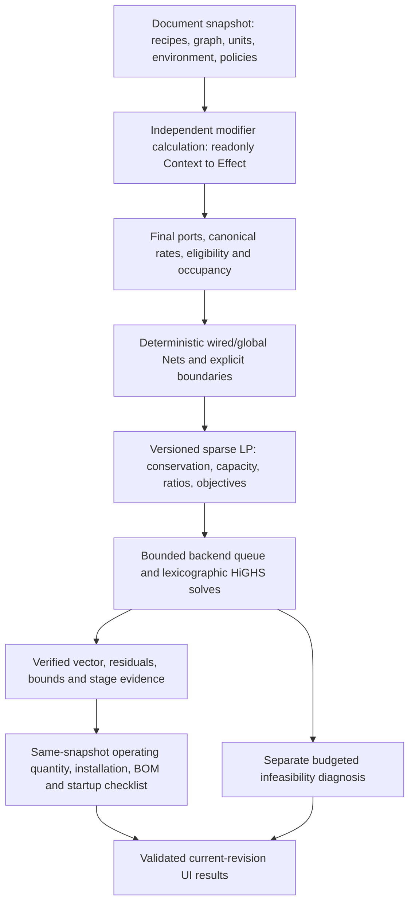

# OmniFlow

English | [中文](docs/README_CN.md)

[Documentation index](docs/README.md)

[Documentation index](docs/README.md)

**A visual industrial-line planner with deterministic recipe compilation and sparse linear programming.**

OmniFlow uses React Flow to connect recipes, sources, delivery targets and fixed-ratio splitters. Resource identity, persistent port identity and units are separate, so the same resource can serve independent process and utility networks. Game-specific rules such as GregTech parallelism and overclocking live in modifier plugins.

## Current calculation path



The modifier computation registry and pipeline do not import React, stores or card renderers. Each recipe is evaluated once per compilation from an explicit environment snapshot. Plugins return effects; the pipeline applies them in dependency-checked order. GregTech parallel and overclock definitions share pure rules with their separately registered UI cards. Parallel configuration affects subsequent overclocking, and unsupported orderings fail explicitly.

The frontend compiles all business rules. The backend accepts only `omniflow.lp.v1` mathematical requests with sparse equalities/inequalities, explicit bounds and prioritized objective layers. It does not classify Recipe/Source/Target nodes or create automatic spill variables. Each accepted vector is checked against original constraints, bounds and previous objective locks.

### Network and objective semantics

- `wired` ports share only their explicit connected network. `global` ports share a pool by scope, resource and bus; global routing supplies no material or energy by itself.
- Supply and spill require explicit boundaries. Every internal flow Net is conserved; an unconnected input cannot manufacture resources, and a closed coproduct can prevent production.
- Delivery supports at-least, exact and maximize policies. Same-priority objectives use explicit normalized weights or fixed ratios; lexicographic priority does not use a big-M coefficient.
- Capacity is an upper constraint. Unused dispatchable generating capacity is slack, not discarded energy. Fixed state requirements are checked at the selected operating condition.
- Splitters enforce allocation ratios, including blocked and zero-ratio branches. They are continuous flow devices, not rounded machine counts.
- Units support registered prefixes, multiplication/division and integer powers. TPS and cycle duration are explicit; display-only unit changes preserve physical quantities.

### Truthful results and limits

Results distinguish `operating_equivalent`, `recommended_installed`, fixed/planned/existing installation and utilization. Logistics use the continuous operating quantity; final-condition catalyst/occupancy BOM uses the selected installation plan. Steady-state cycles and declared preheat/catalyst requirements are shown as startup conditions requiring confirmation, not a proof of dynamic startup.

Requests and responses carry request identity, document revision and compiler fingerprint. Runtime validation and calculation sessions reject stale or incompatible results. `limit_reached` may carry a verified feasible plan without a complete optimality proof. Elastic diagnostic vectors stay separate from normal logistics/BOM, and active limits do not by themselves prove that expansion has value.

The backend has bounded workers, queue and native thread limits. Queue time shares the total request budget. Explicit cancellation removes queued work; aborting a browser request does not terminate an already running native solve. The current solver is continuous LP, without integer installation optimization, inventory dynamics or automatic operating-condition selection.

## Development

The locked Vite version requires Node `^20.19.0 || >=22.12.0`; pinned NumPy/SciPy require Python 3.11 or later. The current validated environment uses Node 24.13.0 and Python 3.14.0.

From the repository root:

```powershell
npm ci
python -m venv .venv
.venv/Scripts/python.exe -m pip install -r backend/requirements-dev.txt
.venv/Scripts/python.exe -m uvicorn backend.main:app --reload --port 7998
```

In another terminal, run `npm run dev` for Vite on port 5173. Set `VITE_BACKEND_URL` to the backend port using `.env.example`. For runtime-only Python dependencies, install `backend/requirements.txt`. API documentation is available at [http://localhost:7998/docs](http://localhost:7998/docs).

```powershell
npm test
.venv/Scripts/python.exe -m pytest backend/tests -q
npm run build
npm run lint
npm run preview
```

Both `/api/calculate` and `/api/debug` use the same LP runtime; debug returns solver stages and residual evidence and currently performs a solve. The old graph payload is rejected. See the [solver contract](docs/solver-lp.md) and [testing guide](docs/testing.md).

## Persistence and validation

Version-5 JSON documents contain authoritative recipes, persistent ports, units/environment, registry and explicit network policies. The shared reader migrates older documents with visible assumptions and repair messages. Clipboard, history and database canvas paths preserve the relevant configuration; no legacy mathematical solver is retained after migration. The local canvas save key is `omniflow.canvas.v1`; its name is independent of the document format version.

Current closeout results and remaining warnings are recorded in [testing](docs/testing.md); earlier counts below belong to their original validation snapshots. Browser observations and exact acceptance boundaries are recorded in the [T01–T24 matrix](docs/validation/v2-completion/acceptance-matrix.md) and [validation ledger](docs/validation/v2-completion/README.md). Performance reports state measured hardware and datasets rather than universal latency or frame-rate guarantees.

## Project structure

```text
src/common/                 Shared types, Zod schemas, unit algebra, utilities and database
src/data/archetypes/        Machine templates
src/features/calculation/  Final-port Net compiler, result projection, installation and diagnostics
src/features/modifier/     Pure calculation definitions and separately registered UI cards
src/features/canvas/       Canvas state, nodes, splitters and history
src/features/recipe/       Authoritative editable recipes and recipe editors
src/features/file-io/      Versioned documents, clipboard and migration
src/features/project/      Project and canvas persistence
backend/main.py            Versioned HTTP routes and runtime lifetime
backend/solver/            Pydantic LP schema, sparse solver and bounded runtime
backend/benchmarks/        Reproducible backend measurement scripts and raw samples
fixtures/                  Cross-language LP, compiler and diagnostic evidence
```

The [v2 design](docs/technical-design-v2-proposal.md), [implementation plan](docs/v2-implementation-plan.md) and acceptance matrix distinguish current behavior from historical proposals.

## License

GPL-3.0 license
