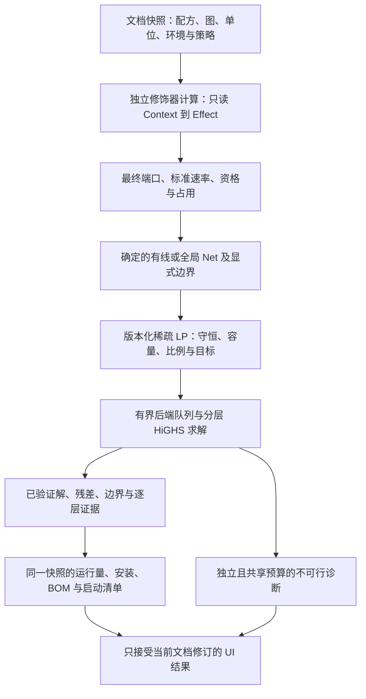

# OmniFlow

[English](../README.md) | 中文

[开发与设计文档导航](README.md)

[开发与设计文档导航](README.md)

**用于工业产线规划的可视化节点编辑器，采用确定性配方编译和稀疏线性规划。**

OmniFlow 使用 React Flow 连接配方、来源、交付目标与固定比例分流器。资源身份、持久端口身份及单位分别建模，因此同一资源可以属于独立的加工和基建网络。格雷科技并行、超频等游戏规则由修饰器插件负责。

## 当前计算流程



修饰器计算注册表和管线不导入 React、store 或卡片组件。每次编译使用显式环境快照，每个配方只运行一次管线。插件返回 Effect，由管线按已校验的依赖顺序应用。格雷科技计算插件与独立注册的 UI 卡片共享纯规则；并行配置影响后续超频，不支持的执行顺序会明确报错。

前端负责业务编译。后端只接收 `omniflow.lp.v1` 数学请求，包含稀疏等式/不等式、显式变量边界和优先级目标层；不再分类 Recipe/Source/Target 节点或自动补排放变量。每个可公开的解都回代检查原约束、变量边界和先前目标锁。

### 网络与目标语义

- `wired` 端口仅共享明确连接的网络；`global` 按 scope、resource、bus 共享池，全局路由本身不供应物料或能量。
- 外供、交付和排放需要显式边界。每个内部 flow Net 守恒；未接输入不会免费生产，封闭副产物可能阻止生产。
- 交付支持至少、恰好和最大化。同优先级目标采用显式参考尺度与权重或固定配比，分层优先级不使用大 M 系数。
- 容量使用上限约束；可调度发电的未用能力是余量，不是废能排放。状态要求在选定工况下校验。
- 分流器保证分配比例，包含堵塞和零比例支路；其吞吐为连续变量，不计机器台数或取整。
- 单位支持注册前缀、乘除与整数次幂。TPS 和周期显式输入；只改变显示单位不会改变物理量。

### 结果与能力边界

结果区分 `operating_equivalent`、`recommended_installed`、固定/计划/已有安装数及利用率。物流使用连续运行量；最终工况的催化剂/占用 BOM 使用选定安装方案。稳态循环和声明的预热/催化剂条件作为待确认启动清单展示，不证明动态可启动。

请求与响应关联 request identity、document revision 和 compiler fingerprint。运行时校验和 calculation session 拒绝过期或不匹配的结果。`limit_reached` 可以携带已验证可行方案，但不表示所有目标层已证明最优。弹性诊断向量独立于正常物流和 BOM；满载本身不证明增容有收益。

后端限制工作线程、排队长度和原生求解线程；排队共享总请求预算。取消接口只能移除尚未执行的任务，浏览器 abort 不会终止已运行的原生求解。当前为连续 LP，不包含整数安装优化、库存时序或自动工况选择。

## 开发与配置

锁定的 Vite 要求 Node `^20.19.0 || >=22.12.0`，固定版本 NumPy/SciPy 要求 Python 3.11 及以上。当前验证环境使用 Node 24.13.0、Python 3.14.0。

在仓库根目录执行：

```powershell
npm ci
python -m venv .venv
.venv/Scripts/python.exe -m pip install -r backend/requirements-dev.txt
.venv/Scripts/python.exe -m uvicorn backend.main:app --reload --port 7998
```

另开终端执行 `npm run dev`，Vite 使用 5173 端口。按 `.env.example` 设置 `VITE_BACKEND_URL` 匹配后端；仅运行时依赖使用 `backend/requirements.txt`。接口文档：[http://localhost:7998/docs](http://localhost:7998/docs)。

```powershell
npm test
.venv/Scripts/python.exe -m pytest backend/tests -q
npm run build
npm run lint
npm run preview
```

`/api/calculate` 与 `/api/debug` 共用 LP 运行池；debug 当前同样执行求解并返回阶段和残差证据。旧图节点 payload 明确拒绝，详见[求解器契约](solver-lp.md)和[测试指南](testing.md)。

## 持久化与验证

文件格式 v5 保存权威配方、持久端口、单位/环境、资源注册表与显式网络策略。旧文件经统一读取器迁移，并展示假设变化和待修复信息；剪贴板、撤销/重做、数据库画布路径保留相应配置。迁移后只使用一套严格编译器，不保留旧数学回退。局部画布保存键仍为 `omniflow.canvas.v1`，该键名与文件格式版本独立。

最新收尾检查和保留告警见[测试记录](testing.md)；历史验收数量仅代表当时快照。浏览器观察和每项验收边界见 [T01–T24 矩阵](validation/v2-completion/acceptance-matrix.md)与[验证记录](validation/v2-completion/README.md)。性能报告按硬件和固定数据集记录实测，不承诺通用固定耗时或帧率。

## 项目结构

```text
src/common/                 共享类型、Zod schema、单位代数、工具和数据库
src/data/archetypes/        机器模板
src/features/calculation/  最终端口 Net 编译、结果投影、安装与诊断
src/features/modifier/     纯计算定义与独立注册的 UI 卡片
src/features/canvas/       画布状态、节点、分流器与历史
src/features/recipe/       权威可编辑配方及编辑器
src/features/file-io/      版本化文档、剪贴板与迁移
src/features/project/      项目及画布持久化
backend/main.py            版本化 HTTP 路由与运行池生命周期
backend/solver/            Pydantic LP schema、稀疏求解与有界执行
backend/benchmarks/        可重复后端测量脚本及原始样本
fixtures/                  跨语言 LP、编译器及诊断证据
```

[v2 设计](technical-design-v2-proposal.md)、[实施计划](v2-implementation-plan.md)与验收矩阵区分当前实现与历史提案。

[交互设计手册](interaction-design-handbook.md)记录 v2 前操作基准、功能入口归属、局部产线建模及后续 UI 改动约定。修改交互时先核对手册与历史实现。

## 许可证

GPL-3.0 license
